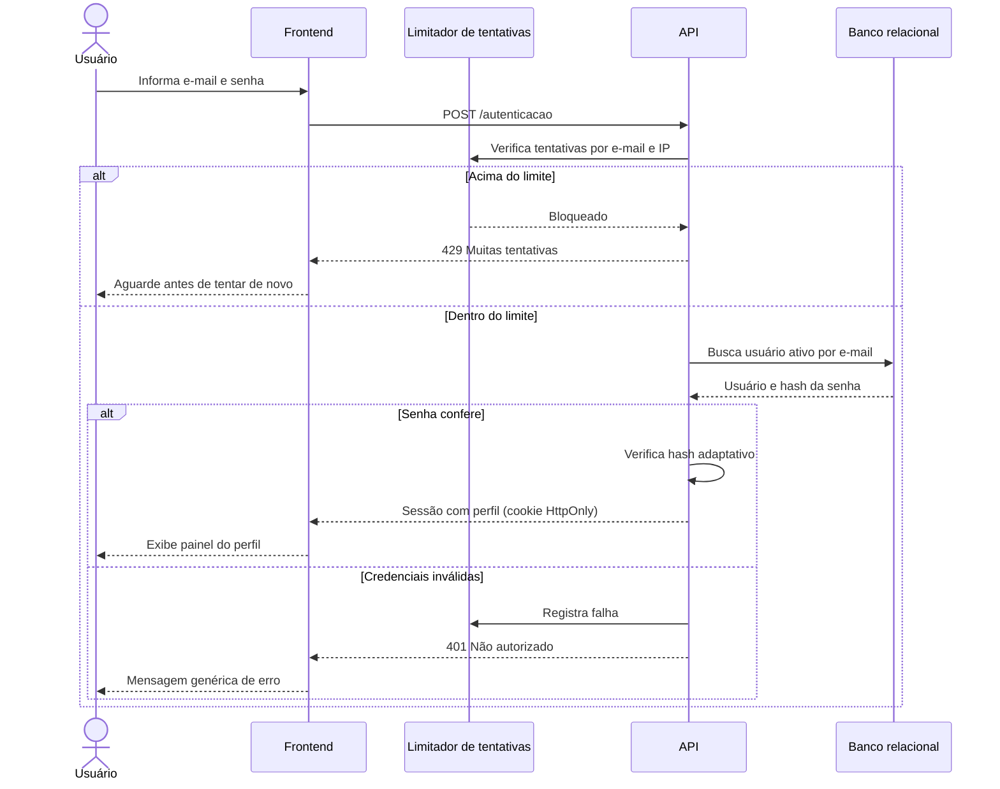

# RF01 — Login por perfil

**Requisito:** login de Admin, Gestor e Cliente com e-mail e senha, exibindo o painel conforme o perfil.
**Personas:** Todas.
**RNFs realizados:** [RNF28](../../requisitos-nao-funcionais.md) (autenticação segura), [RNF30](../../requisitos-nao-funcionais.md) (força bruta).
**Entidades:** Usuario, Perfil, Cliente ([classes](../estatica/classes.md)).

## Diagrama de sequência

## Notas de RNF

- **RNF28:** a senha é comparada por hash adaptativo, nunca em texto claro. A sessão é emitida com expiração por inatividade.
- **RNF30:** o limitador conta falhas por e-mail e por IP. Acima do limite, a API responde 429 sem consultar o banco.
- A mensagem de erro é genérica, para não revelar se o e-mail existe.
