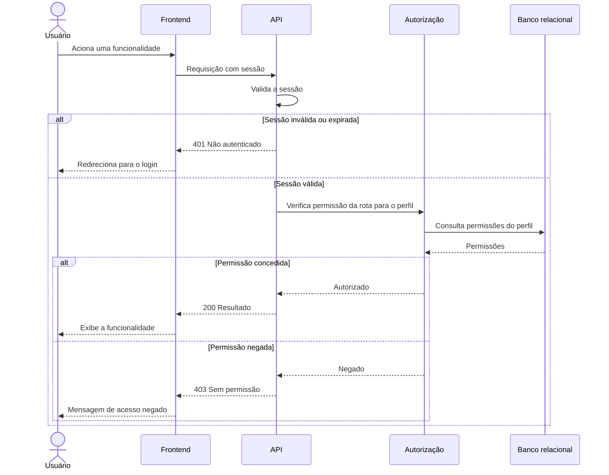

# RF02 — Controle de acesso por perfil

**Requisito:** restringir o acesso a cada funcionalidade conforme o perfil do usuário autenticado.
**Personas:** Todas.
**RNFs realizados:** [RNF29](../../requisitos-nao-funcionais.md) (autorização no servidor).
**Entidades:** Usuario, Perfil, Permissao ([classes](../estatica/classes.md)).

## Diagrama de sequência

## Notas de RNF

- **RNF29:** a verificação acontece no servidor, em toda rota. O frontend esconder um botão não substitui essa checagem.
- A resposta 403 não revela dados da funcionalidade protegida.
