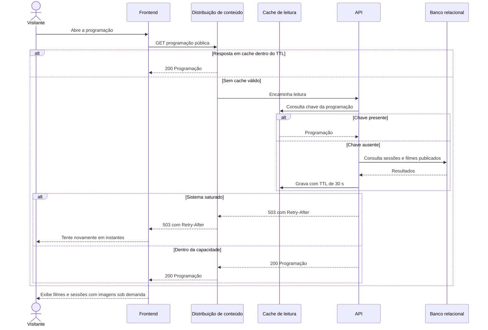

# RF03 — Consulta pública da programação

**Requisito:** usuários não autenticados consultam filmes em cartaz e sessões disponíveis.
**Personas:** Visitante.
**RNFs realizados:** [RNF06](../../requisitos-nao-funcionais.md) (latência de leitura), [RNF08](../../requisitos-nao-funcionais.md) (vazão), [RNF09](../../requisitos-nao-funcionais.md) (LCP), [RNF11](../../requisitos-nao-funcionais.md) (CLS), [RNF12](../../requisitos-nao-funcionais.md) (bundle), [RNF13](../../requisitos-nao-funcionais.md) (imagens), [RNF14](../../requisitos-nao-funcionais.md) (cache), [RNF27](../../requisitos-nao-funcionais.md) (degradação).
**Entidades:** Filme, Sala, Sessao ([classes](../estatica/classes.md)).

## Diagrama de sequência

## Notas de RNF

- **RNF14:** a leitura pública passa por cache com TTL de 30 s. Isso tira a maior parte da carga de C1 do banco.
- **RNF06 e RNF08:** a leitura do cache é a caminho rápido que sustenta a carga de 10.000 usuários.
- **RNF27:** em saturação, a resposta traz `Retry-After` e a interface mostra mensagem, sem tela em branco.
- **RNF09, RNF11, RNF12 e RNF13:** tratados no frontend, com imagens de tamanho responsivo e carregamento preguiçoso.
