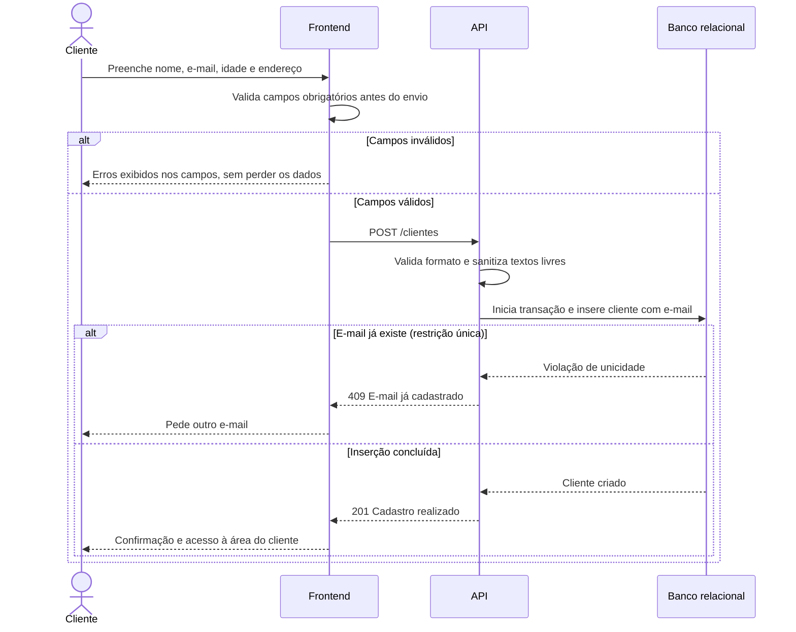

# RF04 — Cadastro do cliente

**Requisito:** o cliente cria a própria conta com nome, e-mail, idade e endereço.
**Personas:** Cliente.
**RNFs realizados:** [RNF03](../../requisitos-nao-funcionais.md) (unicidade sob concorrência), [RNF22](../../requisitos-nao-funcionais.md) (validação de formulário), [RNF31](../../requisitos-nao-funcionais.md) (saneamento), [RNF32](../../requisitos-nao-funcionais.md) (LGPD), [RNF41](../../requisitos-nao-funcionais.md) (migrações).
**Entidades:** Cliente, Endereco, Usuario ([classes](../estatica/classes.md)).

## Diagrama de sequência

## Notas de RNF

- **RNF03:** a unicidade do e-mail é garantida pela restrição do banco, não só pela checagem prévia. Dois cadastros simultâneos não criam duas contas.
- **RNF22:** o frontend valida antes do envio e mantém os dados digitados quando há erro.
- **RNF31:** a API sanitiza campos livres e não confia na validação do cliente.
- **RNF32:** só os dados necessários são coletados, com finalidade declarada.
- **RNF41:** a tabela de clientes e o endereço vêm de migração versionada, sem alteração manual no banco.
