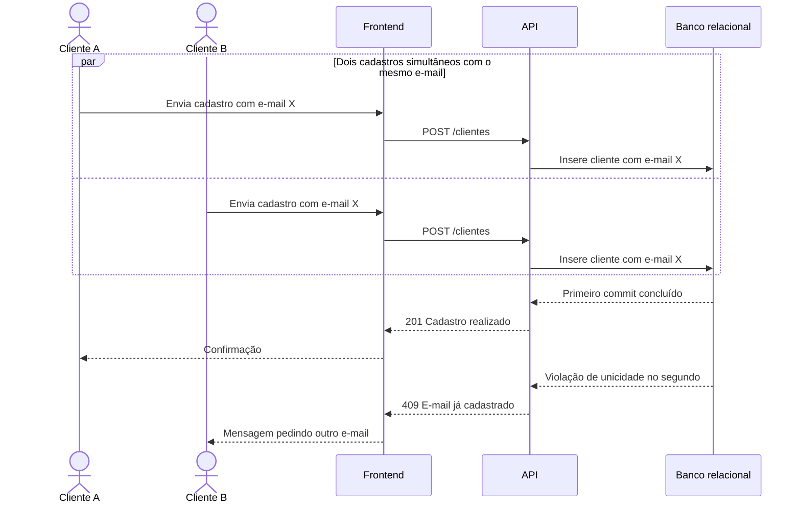

# RF05 — E-mail único

**Requisito:** validar que o e-mail do cliente é único no sistema.
**Personas:** Cliente, Admin.
**RNFs realizados:** [RNF03](../../requisitos-nao-funcionais.md) (unicidade sob concorrência), [RNF20](../../requisitos-nao-funcionais.md) (mensagem clara de conflito).
**Entidades:** Cliente ([classes](../estatica/classes.md)).

## Diagrama de sequência

Este diagrama mostra a corrida entre dois cadastros com o mesmo e-mail. O caminho principal de cadastro está em [RF04](RF04-cadastro-cliente.md).

## Notas de RNF

- **RNF03:** a restrição única do banco decide o vencedor. Não há janela entre a checagem e a inserção que permita duplicidade.
- **RNF20:** o 409 vira mensagem específica, com a ação sugerida (trocar o e-mail ou recuperar a conta).
