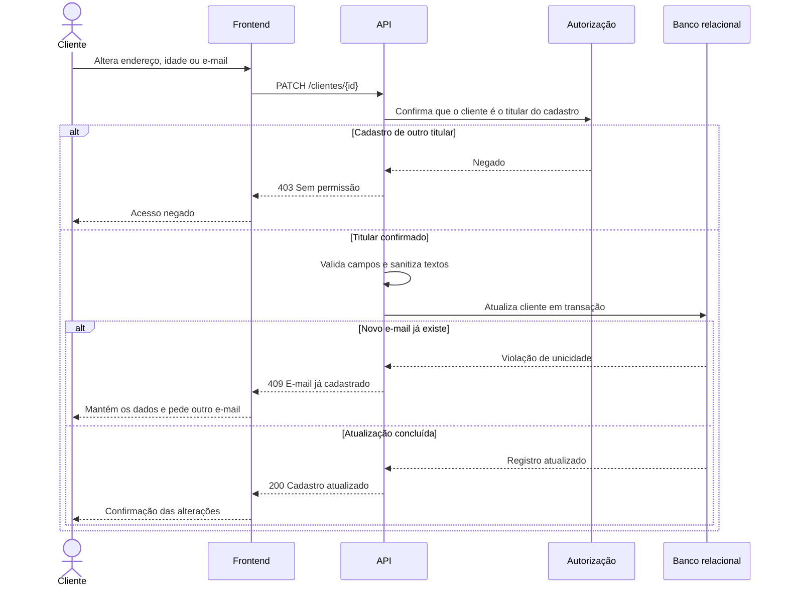

# RF06 — Edição do cadastro do cliente

**Requisito:** o cliente edita os próprios dados de cadastro (endereço, idade e e-mail).
**Personas:** Cliente.
**RNFs realizados:** [RNF03](../../requisitos-nao-funcionais.md) (unicidade ao trocar e-mail), [RNF29](../../requisitos-nao-funcionais.md) (autorização por titularidade), [RNF31](../../requisitos-nao-funcionais.md) (saneamento), [RNF32](../../requisitos-nao-funcionais.md) (LGPD).
**Entidades:** Cliente, Endereco, Usuario ([classes](../estatica/classes.md)).

## Diagrama de sequência

## Notas de RNF

- **RNF29:** o `{id}` da rota não basta. O servidor confirma que a sessão é do titular, para impedir alteração de outro cadastro.
- **RNF03:** trocar e-mail passa pela mesma restrição única do cadastro.
- **RNF32:** a exibição dos dados após a edição fica restrita ao titular.
- **RNF31:** nome, endereço e demais textos editados passam pelo mesmo saneamento do cadastro.
