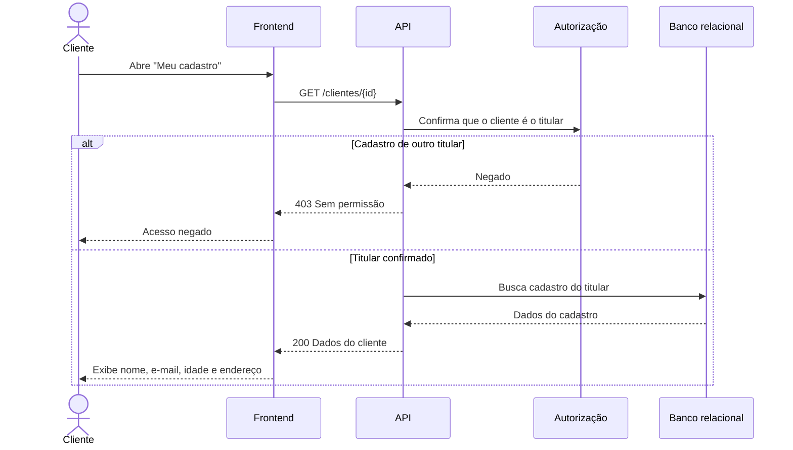

# RF07 — Visualização do cadastro do cliente

**Requisito:** o cliente visualiza os próprios dados de cadastro.
**Personas:** Cliente.
**RNFs realizados:** [RNF29](../../requisitos-nao-funcionais.md) (autorização por titularidade), [RNF32](../../requisitos-nao-funcionais.md) (LGPD: acesso restrito ao titular).
**Entidades:** Cliente, Endereco ([classes](../estatica/classes.md)).

## Diagrama de sequência

## Notas de RNF

- **RNF29:** a checagem de titularidade acontece no servidor, antes de qualquer leitura.
- **RNF32:** a resposta contém apenas os dados do próprio titular. Nenhum campo de outro cliente sai da API.
- A mesma checagem de titularidade vale para [RF06](RF06-edicao-cadastro-cliente.md), e a regra é a mesma em RNF29.
