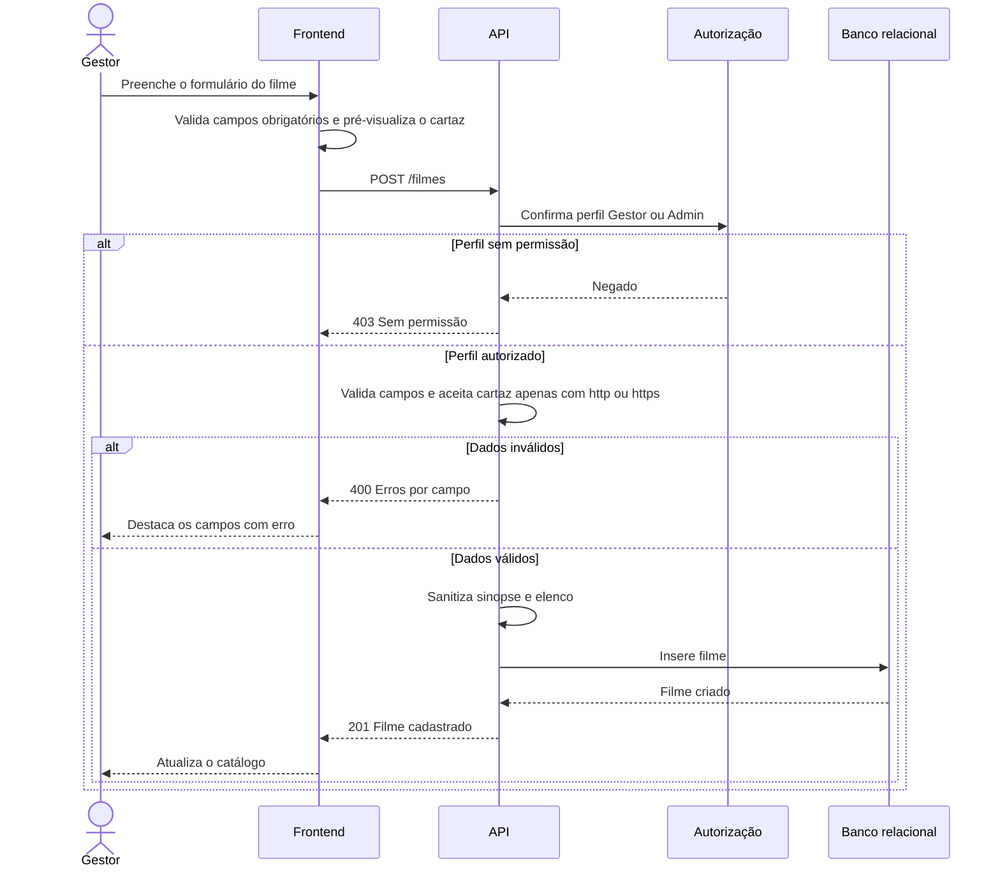

# RF08 — Cadastro de filme

**Requisito:** cadastrar filme com título, duração, gênero, sinopse, cartaz (URL), faixa etária, elenco e nacionalidade.
**Personas:** Gestor, Admin.
**RNFs realizados:** [RNF05](../../requisitos-nao-funcionais.md) (cota nacional, fica disponível para RF19), [RNF13](../../requisitos-nao-funcionais.md) (imagens), [RNF22](../../requisitos-nao-funcionais.md) (validação), [RNF31](../../requisitos-nao-funcionais.md) (URL e texto seguros), [RNF37](../../requisitos-nao-funcionais.md) (componente de formulário), [RNF41](../../requisitos-nao-funcionais.md) (migrações).
**Entidades:** Filme, FaixaEtaria, NacionalidadeFilme ([classes](../estatica/classes.md)).

## Diagrama de sequência

## Notas de RNF

- **RNF31:** o cartaz precisa ser `http` ou `https`. Uma URL com `javascript:` é rejeitada na API, não só no frontend.
- **RNF22:** o formulário sinaliza os campos obrigatórios antes do envio. A API valida de novo.
- **RNF05:** a nacionalidade gravada aqui alimenta a cota de [RF18](RF18-indicador-cota-nacional.md) e a regra de [RF19](RF19-bloqueio-publicacao.md).
- **RNF13:** o cartaz é exibido como miniatura otimizada, com carregamento preguiçoso na lista.
- **RNF37:** o formulário do filme é componente reutilizável, com testes próprios.
- **RNF41:** os campos do filme vêm de migração versionada, derivada do DBML.
