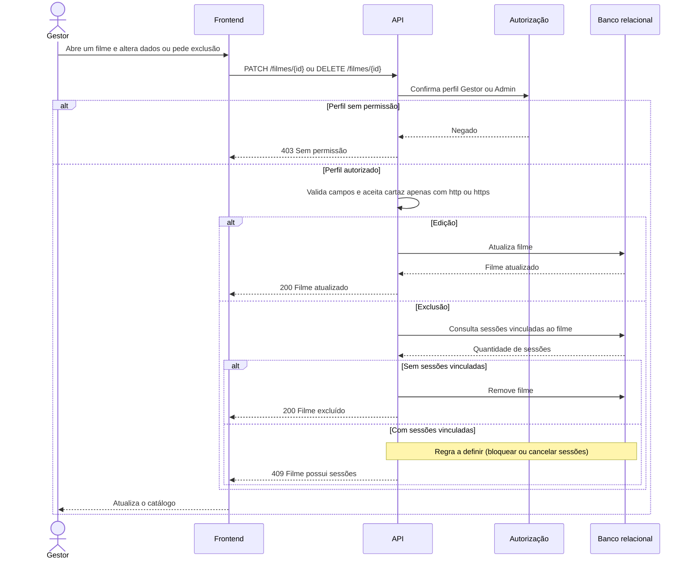

# RF09 — Edição e exclusão de filme

**Requisito:** editar e excluir filmes do catálogo.
**Personas:** Gestor, Admin.
**RNFs realizados:** [RNF13](../../requisitos-nao-funcionais.md) (imagens), [RNF29](../../requisitos-nao-funcionais.md) (autorização), [RNF31](../../requisitos-nao-funcionais.md) (URL e texto seguros), [RNF37](../../requisitos-nao-funcionais.md) (componente de formulário).
**Entidades:** Filme, Sessao ([classes](../estatica/classes.md)).

## Diagrama de sequência

A exclusão de filme que já tem sessões vinculadas ainda não tem regra definida no RF09. O diagrama marca esse ponto como **a definir**.

## Notas de RNF

- **RNF29:** a rota de exclusão tem a mesma checagem de perfil que a de criação.
- **RNF31:** a edição de cartaz e sinopse passa pelas mesmas validações de [RF08](RF08-cadastro-filme.md).
- **Pendência:** definir se exclusão com sessões vinculadas bloqueia a operação ou cancela as sessões. Isso afeta [RF16](RF16-edicao-cancelamento-sessao.md) e [RNF33](../../requisitos-nao-funcionais.md).
- **RNF13:** a troca de cartaz segue as mesmas regras de imagem do cadastro.
- **RNF37:** o formulário de edição é o mesmo componente do cadastro.
