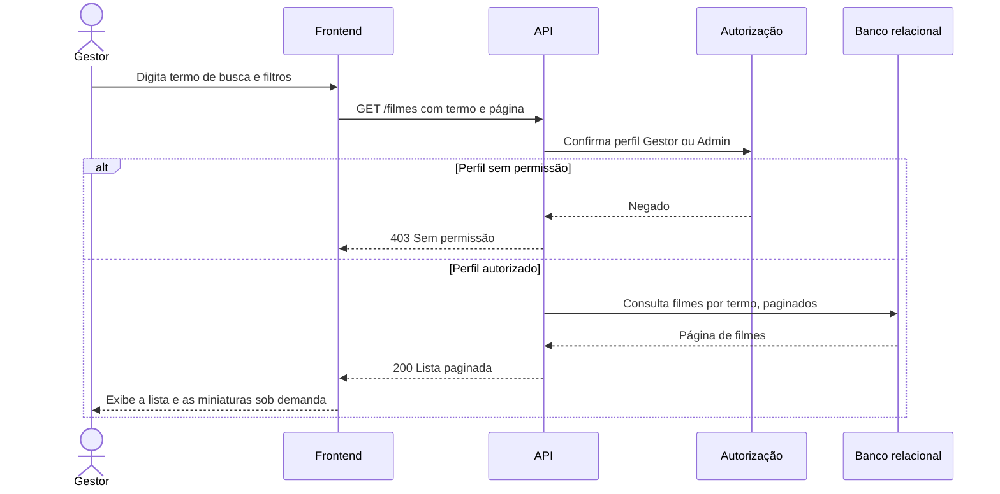

# RF10 — Listagem e busca de filmes

**Requisito:** listar e buscar filmes do catálogo.
**Personas:** Gestor, Admin.
**RNFs realizados:** [RNF06](../../requisitos-nao-funcionais.md) (latência de leitura), [RNF13](../../requisitos-nao-funcionais.md) (imagens), [RNF37](../../requisitos-nao-funcionais.md) (componente de listagem).
**Entidades:** Filme ([classes](../estatica/classes.md)).

## Diagrama de sequência

## Notas de RNF

- **RNF06:** a busca usa paginação, para que a resposta tenha tamanho limitado independentemente do tamanho do catálogo.
- **RNF13:** as miniaturas são carregadas conforme a lista aparece na tela.
- **RNF37:** a listagem e o campo de busca são componentes reutilizáveis, com testes próprios.
