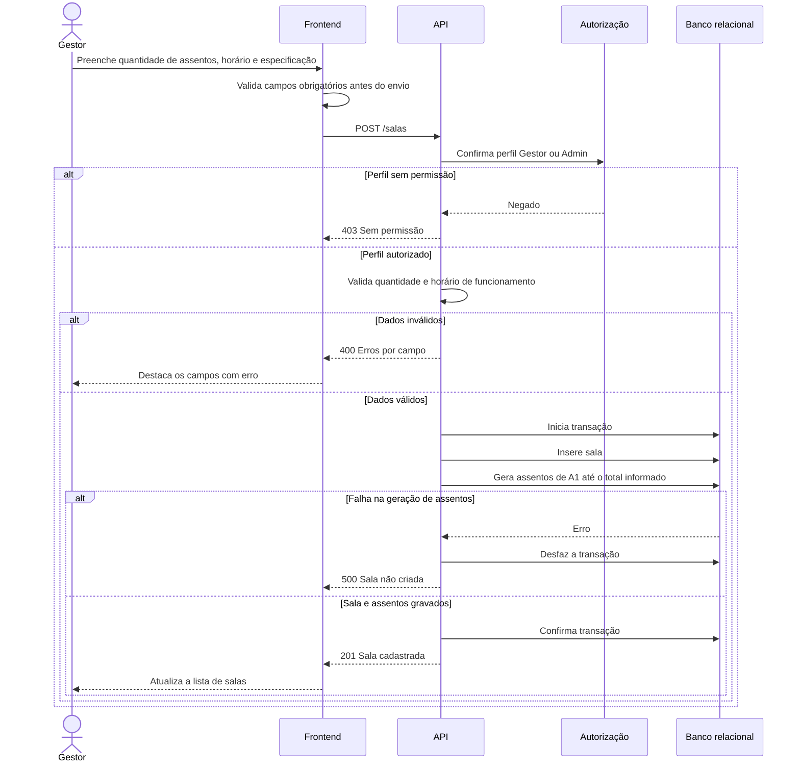

# RF11 — Cadastro de sala

**Requisito:** cadastrar sala com quantidade de assentos, horário de funcionamento e especificação técnica.
**Personas:** Gestor, Admin.
**RNFs realizados:** [RNF22](../../requisitos-nao-funcionais.md) (validação), [RNF37](../../requisitos-nao-funcionais.md) (componente de formulário), [RNF41](../../requisitos-nao-funcionais.md) (esquema e migrações).
**Entidades:** Sala, Assento ([classes](../estatica/classes.md)).

## Diagrama de sequência

## Notas de RNF

- **RNF41:** a sala e seus assentos são criados na mesma transação. Não existe sala sem assentos.
- **RNF22:** o formulário valida antes do envio, e a API valida de novo.
- Os assentos são gerados por código único dentro da sala, o que sustenta a restrição `(sala, codigo)` de [classes](../estatica/classes.md).
- **RNF37:** o formulário de sala é componente reutilizável, com testes próprios.
