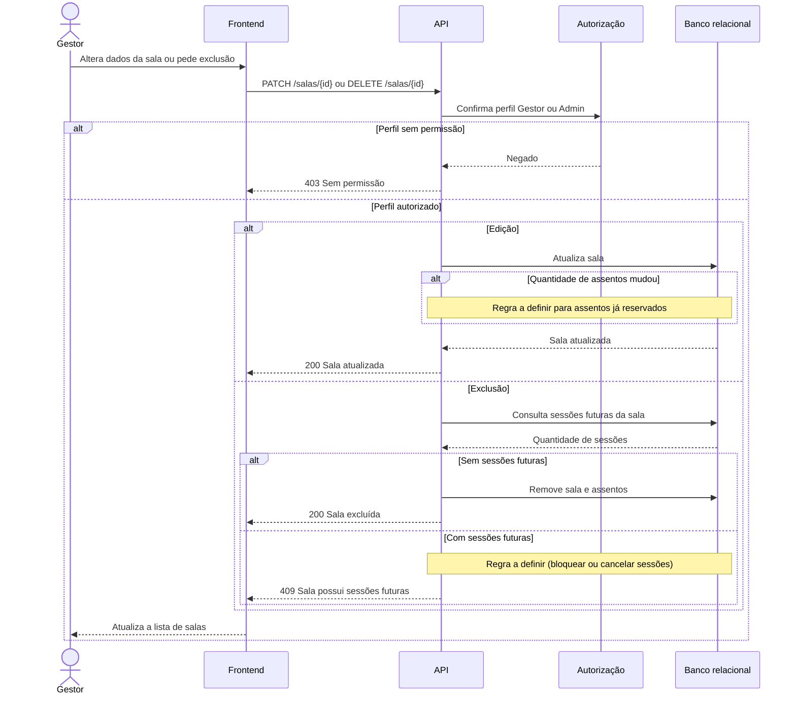

# RF12 — Edição e exclusão de sala

**Requisito:** editar e excluir salas.
**Personas:** Gestor, Admin.
**RNFs realizados:** [RNF29](../../requisitos-nao-funcionais.md) (autorização), [RNF37](../../requisitos-nao-funcionais.md) (componente de formulário).
**Entidades:** Sala, Assento, Sessao ([classes](../estatica/classes.md)).

## Diagrama de sequência

A exclusão de sala com sessões futuras ainda não tem regra definida no RF12. O diagrama marca esse ponto como **a definir**.

## Notas de RNF

- **RNF29:** as rotas de edição e exclusão checam perfil no servidor.
- **Pendência:** definir o que acontece com assentos já reservados se a quantidade mudar, e com sessões futuras na exclusão. Isso afeta [RNF01](../../requisitos-nao-funcionais.md) e [RF16](RF16-edicao-cancelamento-sessao.md).
- **RNF37:** o formulário de edição é o mesmo componente do cadastro de sala.
