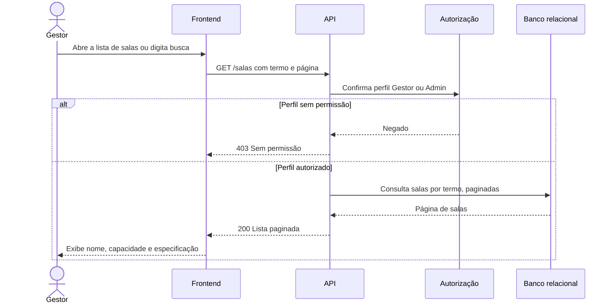

# RF13 — Listagem e busca de salas

**Requisito:** listar e buscar salas.
**Personas:** Gestor, Admin.
**RNFs realizados:** [RNF06](../../requisitos-nao-funcionais.md) (latência de leitura), [RNF37](../../requisitos-nao-funcionais.md) (componente de listagem).
**Entidades:** Sala ([classes](../estatica/classes.md)).

## Diagrama de sequência

## Notas de RNF

- **RNF06:** a lista é paginada, com resposta de tamanho limitado.
- **RNF37:** o componente de lista é o mesmo usado em [RF10](RF10-listagem-busca-filmes.md), com testes compartilhados.
