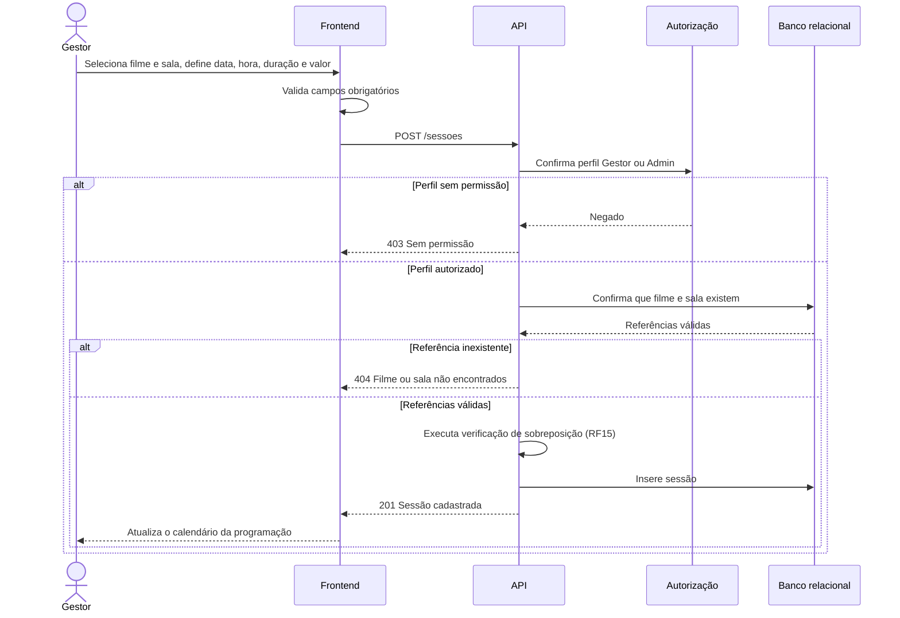

# RF14 — Cadastro de sessão

**Requisito:** cadastrar sessão vinculando filme e sala, com data e hora de início, duração e valor do ingresso.
**Personas:** Gestor, Admin.
**RNFs realizados:** [RNF04](../../requisitos-nao-funcionais.md) (sem sobreposição sob concorrência), [RNF22](../../requisitos-nao-funcionais.md) (validação), [RNF41](../../requisitos-nao-funcionais.md) (migrações).
**Entidades:** Sessao, Filme, Sala ([classes](../estatica/classes.md)).

## Diagrama de sequência

O caminho de sobreposição, que é o ponto de concorrência, está em [RF15](RF15-sobreposicao-sessao.md). Este diagrama mostra o fluxo de sucesso e a validação de referências.

## Notas de RNF

- **RNF04:** a inserção acontece dentro da transação com bloqueio por sala descrita em [RF15](RF15-sobreposicao-sessao.md). Não há inserção fora dela.
- **RNF22:** o formulário valida antes do envio e a API valida de novo.
- **RNF41:** as referências a filme e sala vêm das restrições de chave estrangeira do modelo.
