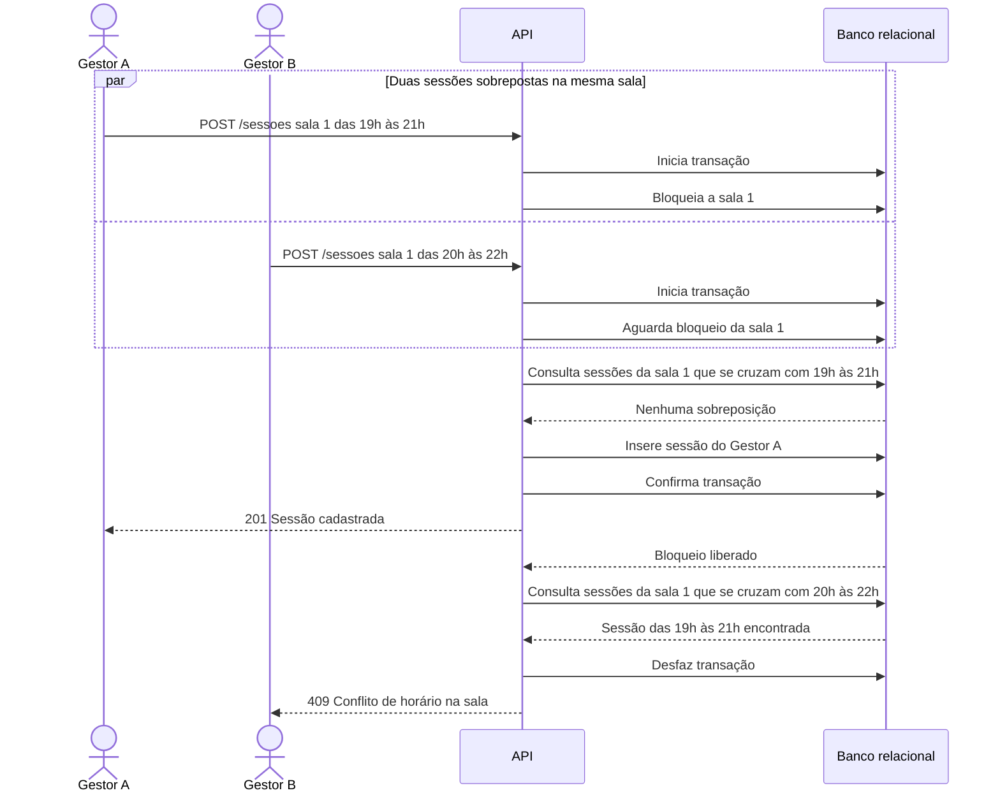

# RF15 — Sobreposição de sessão na sala

**Requisito:** validar que a nova sessão não se sobrepõe a outra sessão da mesma sala.
**Personas:** Gestor, Admin.
**RNFs realizados:** [RNF04](../../requisitos-nao-funcionais.md) (sem sobreposição sob concorrência), [RNF20](../../requisitos-nao-funcionais.md) (mensagem de conflito), [RNF34](../../requisitos-nao-funcionais.md) (regra em camada testável).
**Entidades:** Sessao, Sala ([classes](../estatica/classes.md)).

## Diagrama de sequência

Dois gestores cadastram sessões sobrepostas na mesma sala ao mesmo tempo. O bloqueio por sala garante que apenas uma passe.

## Notas de RNF

- **RNF04:** o bloqueio por sala serializa as verificações. Sem ele, as duas consultas veriam a sala livre e as duas sessões seriam gravadas.
- **Intervalo:** a sobreposição usa `[início, início + duração)`, então uma sessão que termina às 21h e outra que começa às 21h não conflitam.
- **RNF20:** o 409 informa o horário da sessão que causou o conflito.
- **RNF34:** a comparação de intervalos fica em serviço de programação testável sem a interface.
