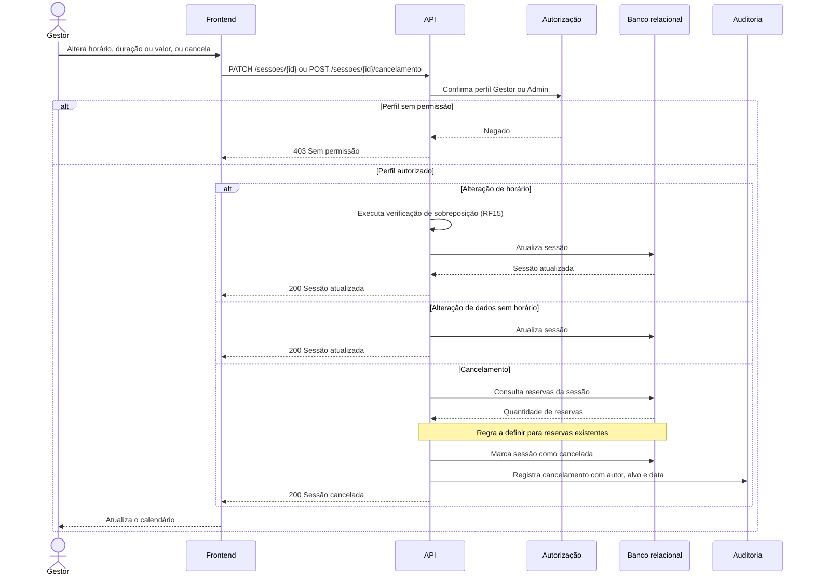

# RF16 — Edição e cancelamento de sessão

**Requisito:** editar e cancelar sessões.
**Personas:** Gestor, Admin.
**RNFs realizados:** [RNF04](../../requisitos-nao-funcionais.md) (sem sobreposição na alteração de horário), [RNF29](../../requisitos-nao-funcionais.md) (autorização), [RNF33](../../requisitos-nao-funcionais.md) (auditoria do cancelamento).
**Entidades:** Sessao, Reserva, RegistroAuditoria ([classes](../estatica/classes.md)).

## Diagrama de sequência

O cancelamento de sessão com reservas já feitas ainda não tem regra definida. O diagrama marca esse ponto como **a definir**.

## Notas de RNF

- **RNF04:** qualquer mudança de horário passa de novo pela verificação de sobreposição de [RF15](RF15-sobreposicao-sessao.md).
- **RNF29:** a checagem de perfil acontece no servidor.
- **RNF33:** o cancelamento grava registro de auditoria com autor, alvo, ação e data.
- **Pendência:** definir o tratamento de reservas de uma sessão cancelada, que afeta [RF30](RF30-cancelamento-reserva-admin.md).
