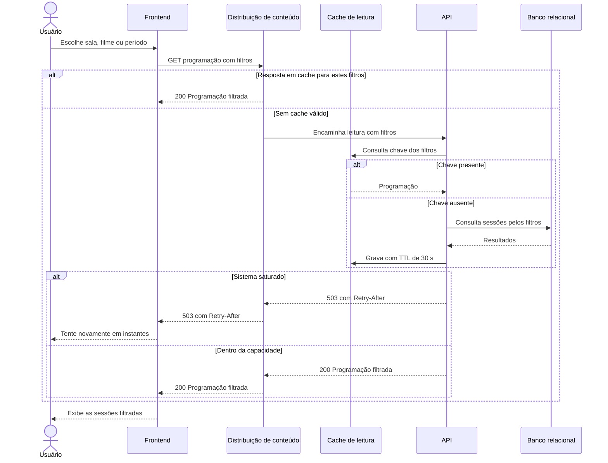

# RF17 — Consulta da programação com filtros

**Requisito:** consultar a programação filtrando por sala, filme ou período.
**Personas:** Visitante, Cliente, Gestor, Admin.
**RNFs realizados:** [RNF06](../../requisitos-nao-funcionais.md) (latência), [RNF08](../../requisitos-nao-funcionais.md) (vazão), [RNF09](../../requisitos-nao-funcionais.md) (LCP), [RNF11](../../requisitos-nao-funcionais.md) (CLS), [RNF12](../../requisitos-nao-funcionais.md) (bundle), [RNF14](../../requisitos-nao-funcionais.md) (cache), [RNF27](../../requisitos-nao-funcionais.md) (degradação).
**Entidades:** Sessao, Filme, Sala ([classes](../estatica/classes.md)).

## Diagrama de sequência

Os filtros entram na chave de cache, então cada combinação de filtros tem sua própria entrada com TTL.

## Notas de RNF

- **RNF14:** a chave de cache inclui os filtros. O TTL de 30 s limita a defasagem da programação.
- **RNF27:** em saturação, a resposta traz `Retry-After` e a interface mostra mensagem.
- Usuários autenticados seguem o mesmo caminho. Nenhuma informação pessoal entra na resposta pública.
- **RNF06:** a leitura filtrada usa índices por sala, filme e período, para manter a resposta abaixo de 300 ms.
- **RNF08:** o cache absorve a repetição de filtros comuns, reduzindo a carga sobre o banco.
- **RNF09, RNF11 e RNF12:** tratados no frontend, como em [RF03](RF03-consulta-publica-programacao.md).
