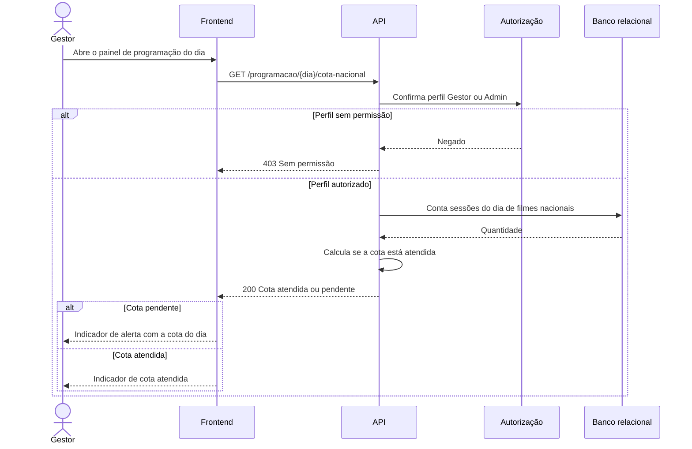

# RF18 — Indicador da cota nacional

**Requisito:** exibir ao Gestor o indicador da cota de filme nacional do dia (RN04).
**Personas:** Gestor, Admin.
**RNFs realizados:** [RNF05](../../requisitos-nao-funcionais.md) (cota aplicada), [RNF34](../../requisitos-nao-funcionais.md) (regra em camada testável).
**Entidades:** Sessao, Filme, NacionalidadeFilme ([classes](../estatica/classes.md)).

## Diagrama de sequência

## Notas de RNF

- **RNF05:** o indicador usa a mesma regra da publicação em [RF19](RF19-bloqueio-publicacao.md). Não há duas definições de cota.
- **RNF34:** a regra de cálculo fica em serviço testável, separada da interface.
- A consulta é do dia da programação, e a nacionalidade vem do cadastro do filme ([RF08](RF08-cadastro-filme.md)).
