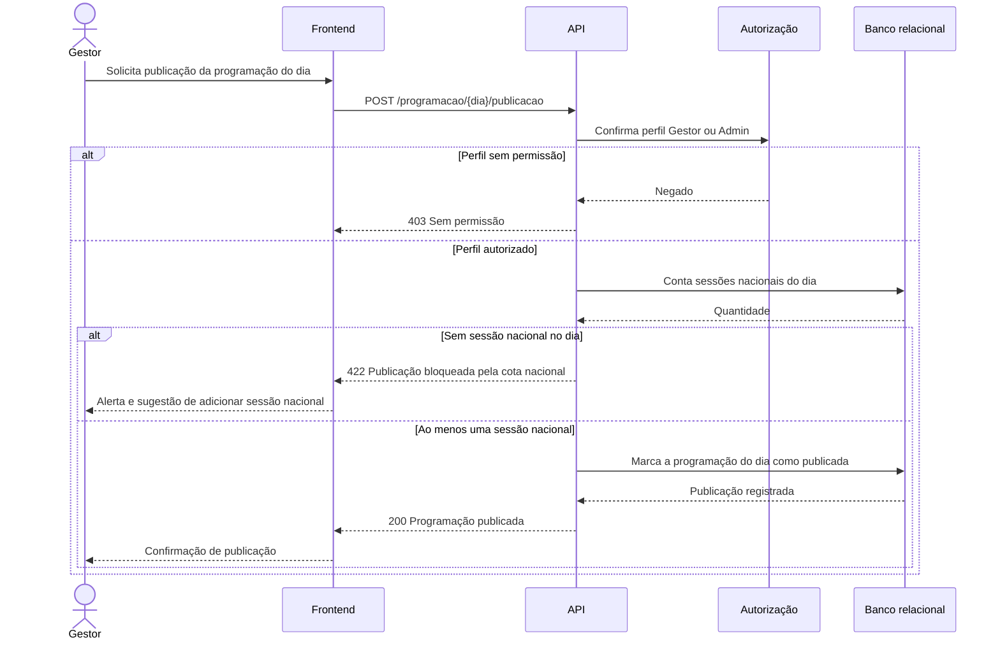

# RF19 — Bloqueio de publicação sem cota nacional

**Requisito:** impedir a publicação da programação de um dia sem ao menos uma sessão de filme nacional (RN04).
**Personas:** Gestor, Admin.
**RNFs realizados:** [RNF05](../../requisitos-nao-funcionais.md) (cota aplicada sempre), [RNF34](../../requisitos-nao-funcionais.md) (regra em camada testável).
**Entidades:** Sessao, Filme, NacionalidadeFilme ([classes](../estatica/classes.md)).

## Diagrama de sequência

## Notas de RNF

- **RNF05:** a regra é aplicada no servidor, na publicação. O painel pode mostrar o alerta, mas não decide sozinho.
- **RNF34:** a regra de cota fica em serviço testável, o mesmo usado em [RF18](RF18-indicador-cota-nacional.md).
- Um 422 indica que a regra de negócio impediu a ação, e não que houve erro técnico.
