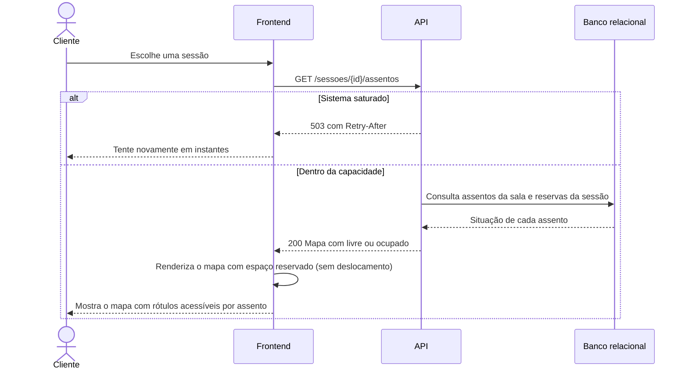

# RF20 — Mapa de assentos

**Requisito:** exibir o mapa de assentos de uma sessão, diferenciando assentos livres e ocupados.
**Personas:** Cliente.
**RNFs realizados:** [RNF06](../../requisitos-nao-funcionais.md) (latência), [RNF08](../../requisitos-nao-funcionais.md) (vazão), [RNF09](../../requisitos-nao-funcionais.md) (LCP), [RNF10](../../requisitos-nao-funcionais.md) (INP), [RNF11](../../requisitos-nao-funcionais.md) (CLS), [RNF12](../../requisitos-nao-funcionais.md) (bundle), [RNF19](../../requisitos-nao-funcionais.md) (acessibilidade do mapa), [RNF21](../../requisitos-nao-funcionais.md) (fluxo curto), [RNF27](../../requisitos-nao-funcionais.md) (degradação), [RNF37](../../requisitos-nao-funcionais.md) (componente de mapa).
**Entidades:** Sessao, Sala, Assento, Reserva ([classes](../estatica/classes.md)).

## Diagrama de sequência

O mapa nunca vem do cache de programação. O estado de ocupação é lido do banco, para não mostrar como livre um assento já reservado (decisão D2).

## Notas de RNF

- **RNF06 e RNF08:** a consulta usa índice por sessão e retorna só o necessário para o mapa.
- **RNF14:** o mapa fica fora do cache de programação. Uma leitura defasada levaria a reservas de assentos já ocupados.
- **RNF09 e RNF11:** o espaço do mapa é reservado antes de os dados chegarem, para não deslocar o layout.
- **RNF19:** cada assento tem rótulo, como "Fila A, assento 7, livre", lido por leitor de tela.
- **RNF37:** o mapa é um componente isolado, com testes próprios.
- **RNF10:** a seleção de assento é local, o que mantém o INP baixo (ver [RF21](RF21-selecao-assentos.md)).
- **RNF12:** o componente de mapa é carregado na página da sessão, fora do pacote inicial da vitrine.
- **RNF21:** o mapa leva direto à seleção, sem etapa intermediária.
- **RNF27:** em saturação, o mapa mostra mensagem com `Retry-After`, em vez de tela vazia.
