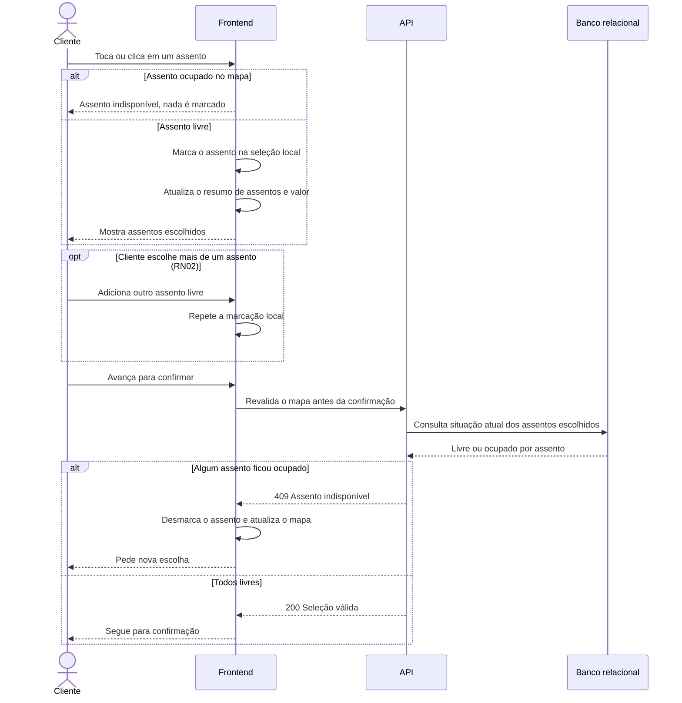

# RF21 — Seleção de assentos

**Requisito:** o cliente seleciona um ou mais assentos livres na mesma sessão (RN02).
**Personas:** Cliente.
**RNFs realizados:** [RNF01](../../requisitos-nao-funcionais.md) (integridade), [RNF02](../../requisitos-nao-funcionais.md) (conflito de horário), [RNF07](../../requisitos-nao-funcionais.md) (latência de escrita), [RNF08](../../requisitos-nao-funcionais.md) (vazão), [RNF10](../../requisitos-nao-funcionais.md) (INP), [RNF19](../../requisitos-nao-funcionais.md) (acessibilidade), [RNF21](../../requisitos-nao-funcionais.md) (fluxo curto), [RNF24](../../requisitos-nao-funcionais.md) (idempotência), [RNF27](../../requisitos-nao-funcionais.md) (degradação), [RNF34](../../requisitos-nao-funcionais.md) (regra testável).
**Entidades:** Assento, Sessao, Reserva ([classes](../estatica/classes.md)).

## Diagrama de sequência

A seleção é local no navegador. Nada é gravado até a confirmação, que é o caso de [RF22](RF22-registro-reserva.md). Assentos ocupados não podem ser escolhidos no mapa.

## Notas de RNF

- **RNF10:** marcar um assento é uma atualização local. O INP fica baixo, sem ida ao servidor a cada clique.
- **RNF01:** a revalidação antes da confirmação é um aviso rápido ao cliente. A garantia real vem da restrição única em [RF22](RF22-registro-reserva.md).
- **RNF19:** assentos são botões com rótulo e estado, operáveis por teclado.
- **RNF24:** a seleção não cria reserva, então nenhum reenvio pode duplicá-la.
- **RNF21:** a seleção não cria etapas extras entre escolher e confirmar.
- **RNF02:** a revalidação antes da confirmação também checa conflito de horário, junto com [RF24](RF24-conflito-horario-cliente.md).
- **RNF07:** a seleção não grava nada, então não pesa na latência de escrita. A escrita fica em [RF22](RF22-registro-reserva.md).
- **RNF08:** a seleção é local e não gera carga no servidor. A revalidação é uma leitura curta.
- **RNF27:** se a revalidação falhar por saturação, a seleção permanece e o cliente pode tentar de novo.
- **RNF34:** a regra de RN02 (vários assentos) fica no serviço de reservas, não na tela.
