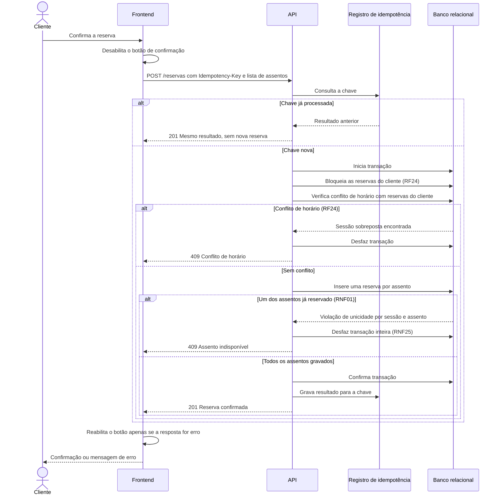

# RF22 — Registro da reserva

**Requisito:** registrar a reserva de cada assento selecionado, tornando-o válido e ocupado para a sessão (RN01).
**Personas:** Cliente.
**RNFs realizados:** [RNF01](../../requisitos-nao-funcionais.md) (integridade), [RNF07](../../requisitos-nao-funcionais.md) (latência de escrita), [RNF08](../../requisitos-nao-funcionais.md) (vazão), [RNF21](../../requisitos-nao-funcionais.md) (fluxo curto), [RNF24](../../requisitos-nao-funcionais.md) (idempotência), [RNF25](../../requisitos-nao-funcionais.md) (atomicidade), [RNF26](../../requisitos-nao-funcionais.md) (durabilidade), [RNF34](../../requisitos-nao-funcionais.md) (regra testável), [RNF41](../../requisitos-nao-funcionais.md) (migrações).
**Entidades:** Reserva, Assento, Sessao, Cliente ([classes](../estatica/classes.md)).

## Diagrama de sequência

Este é o fluxo de maior concorrência do sistema. A confirmação usa chave de idempotência, e todos os assentos são gravados numa única transação.

## Notas de RNF

- **RNF01:** a restrição única `(sessão, assento)` no banco é a garantia final. A checagem anterior só melhora a mensagem.
- **RNF25:** se um assento falha, nenhum é gravado. Não existe reserva parcial.
- **RNF24:** a chave de idempotência faz o reenvio de um duplo clique ou de uma retentativa de rede devolver o mesmo resultado.
- **RNF26:** a reserva só recebe 201 depois do commit. Uma queda antes disso não deixa reserva fantasma.
- **RNF07:** o caminho feliz tem uma transação curta, o que sustenta o p95 de 800 ms.
- **Decisão D3 (frontend):** o botão fica desabilitado durante a requisição e só reabilita em caso de erro.
- **RNF08:** a transação curta e a restrição única permitem vazão alta sem bloqueio longo.
- **RNF21:** a resposta 201 já traz a confirmação completa (ver [RF25](RF25-confirmacao-reserva.md)).
- **RNF34:** a regra de múltiplos assentos e de conflito fica em serviço testável.
- **RNF41:** as tabelas de reserva vêm de migração versionada.
