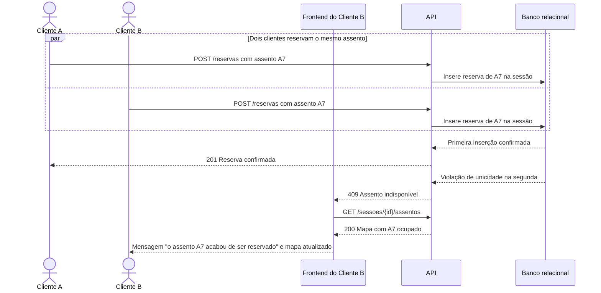

# RF23 — Bloqueio de assento ocupado

**Requisito:** bloquear a seleção ou reserva de um assento já ocupado por outro cliente na mesma sessão (RN01).
**Personas:** Cliente.
**RNFs realizados:** [RNF01](../../requisitos-nao-funcionais.md) (integridade), [RNF20](../../requisitos-nao-funcionais.md) (mensagem clara), [RNF34](../../requisitos-nao-funcionais.md) (regra testável).
**Entidades:** Reserva, Assento, Sessao ([classes](../estatica/classes.md)).

## Diagrama de sequência

Dois clientes tentam o mesmo assento. O segundo é bloqueado pela restrição única, e o mapa é atualizado.

## Notas de RNF

- **RNF01:** o banco decide o vencedor. A segunda reserva nunca é gravada.
- **RNF20:** a mensagem diz o que aconteceu e mostra o mapa atualizado, para o cliente escolher outro assento.
- **RNF34:** a regra de disponibilidade fica em serviço de reservas testável.
