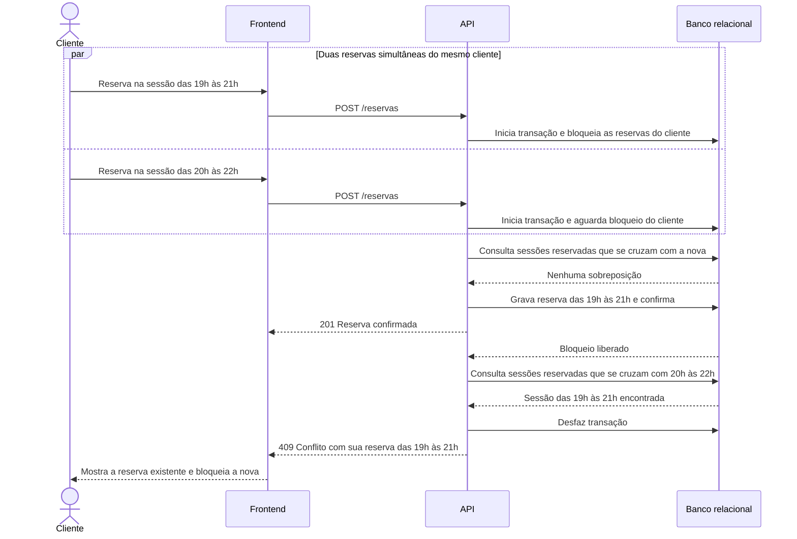

# RF24 — Conflito de horário do cliente

**Requisito:** validar, no momento da reserva, se a sessão escolhida conflita com sessões já reservadas pelo mesmo cliente, bloqueando a operação (RN03).
**Personas:** Cliente.
**RNFs realizados:** [RNF02](../../requisitos-nao-funcionais.md) (conflito sob concorrência), [RNF20](../../requisitos-nao-funcionais.md) (mensagem clara), [RNF34](../../requisitos-nao-funcionais.md) (regra testável).
**Entidades:** Reserva, Sessao, Cliente ([classes](../estatica/classes.md)).

## Diagrama de sequência

O bloqueio por cliente impede que duas reservas simultâneas do mesmo cliente, em sessões sobrepostas, passem juntas.

## Notas de RNF

- **RNF02:** o bloqueio por cliente serializa as reservas do mesmo cliente. Clientes diferentes não se bloqueiam entre si.
- **Intervalo:** a comparação usa `[início, início + duração)`, igual à de [RF15](RF15-sobreposicao-sessao.md).
- **RNF20:** o 409 informa a reserva existente, para o cliente entender o conflito.
- **RNF34:** a comparação de intervalos fica no serviço de reservas, testável sem a interface. É a mesma regra de [RF15](RF15-sobreposicao-sessao.md).
