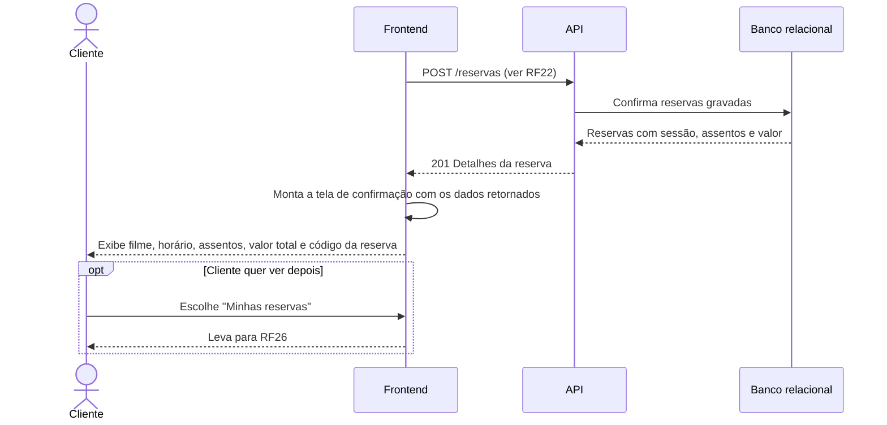

# RF25 — Confirmação da reserva

**Requisito:** exibir ao cliente a confirmação da reserva com sessão, assentos e valor.
**Personas:** Cliente.
**RNFs realizados:** [RNF07](../../requisitos-nao-funcionais.md) (latência de escrita), [RNF21](../../requisitos-nao-funcionais.md) (fluxo curto).
**Entidades:** Reserva, Sessao, Assento ([classes](../estatica/classes.md)).

## Diagrama de sequência

A confirmação é a resposta do registro de [RF22](RF22-registro-reserva.md). Usa os dados já gravados, sem nova escrita.

## Notas de RNF

- **RNF07:** a confirmação vem na mesma resposta do registro. Não há segunda ida ao servidor para montar a tela.
- **RNF21:** a confirmação mostra tudo o que o cliente precisa, sem etapa extra.
- O valor exibido é o mesmo gravado na reserva, para evitar divergência entre tela e registro.
