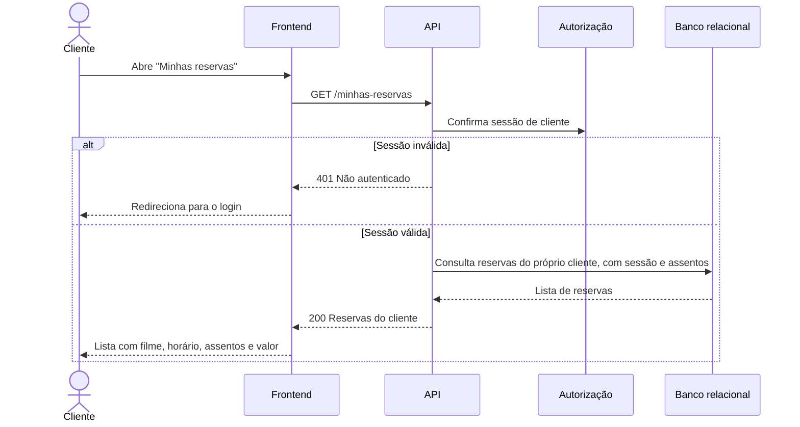

# RF26 — Minhas reservas

**Requisito:** o cliente consulta a lista das próprias reservas.
**Personas:** Cliente.
**RNFs realizados:** [RNF06](../../requisitos-nao-funcionais.md) (latência), [RNF12](../../requisitos-nao-funcionais.md) (bundle), [RNF32](../../requisitos-nao-funcionais.md) (LGPD: só as próprias reservas).
**Entidades:** Reserva, Sessao, Assento, Cliente ([classes](../estatica/classes.md)).

## Diagrama de sequência

## Notas de RNF

- **RNF32:** a consulta usa o identificador da sessão, não um parâmetro de cliente. Não há como pedir reservas de outro cliente.
- **RNF06:** a lista é paginada se o cliente tiver muitas reservas.
- **RNF12:** a tela de reservas é carregada sob demanda, fora do pacote inicial.
