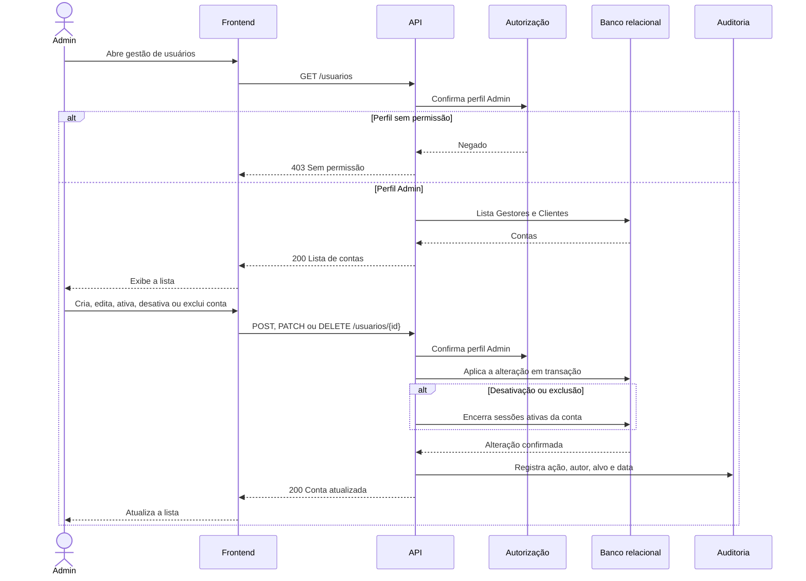

# RF27 — Gestão de contas pelo Admin

**Requisito:** o Admin cria, edita, ativa/desativa e exclui contas de Gestores e Clientes.
**Personas:** Admin.
**RNFs realizados:** [RNF26](../../requisitos-nao-funcionais.md) (durabilidade), [RNF28](../../requisitos-nao-funcionais.md) (senhas e sessão), [RNF29](../../requisitos-nao-funcionais.md) (autorização), [RNF32](../../requisitos-nao-funcionais.md) (LGPD), [RNF33](../../requisitos-nao-funcionais.md) (auditoria).
**Entidades:** Usuario, Perfil, Cliente, RegistroAuditoria ([classes](../estatica/classes.md)). Usuario e RegistroAuditoria são **pendentes**.

## Diagrama de sequência

## Notas de RNF

- **RNF28:** desativar ou excluir conta encerra as sessões dela. Quem foi desativado não continua logado.
- **RNF29:** a rota exige perfil Admin no servidor.
- **RNF33:** toda alteração gera registro de auditoria com autor, ação, alvo e data.
- **RNF32:** exclusão de cliente tem de seguir a política de exclusão de dados pessoais, ainda a definir.
- **Pendência:** a entidade Usuario não está no DBML. Ver [classes.md](../estatica/classes.md).
- **RNF26:** criação, edição, desativação e exclusão são gravadas em transação. Uma queda no meio não deixa conta em estado parcial.
