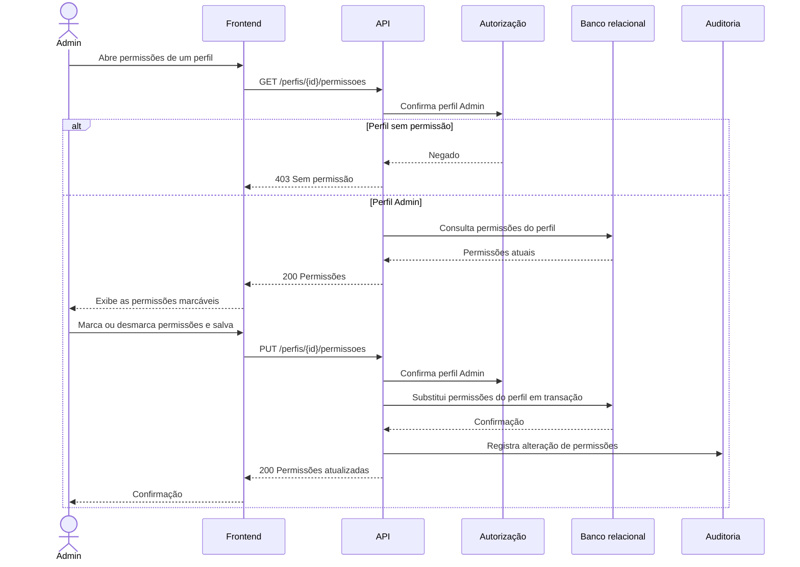

# RF28 — Gestão de permissões dos perfis

**Requisito:** o Admin gerencia as permissões dos perfis de acesso.
**Personas:** Admin.
**RNFs realizados:** [RNF29](../../requisitos-nao-funcionais.md) (autorização no servidor), [RNF33](../../requisitos-nao-funcionais.md) (auditoria).
**Entidades:** Perfil, Permissao, RegistroAuditoria ([classes](../estatica/classes.md)). Todas são **pendentes**.

## Diagrama de sequência

## Notas de RNF

- **RNF29:** a alteração de permissões é a própria regra de autorização. Só o Admin a faz, e o servidor confirma em toda chamada.
- **RNF33:** a alteração grava quem mudou, o perfil, as permissões anteriores e as novas.
- Depois da alteração, a autorização de [RF02](RF02-controle-de-acesso.md) passa a usar as permissões novas, sem esperar a sessão expirar.
