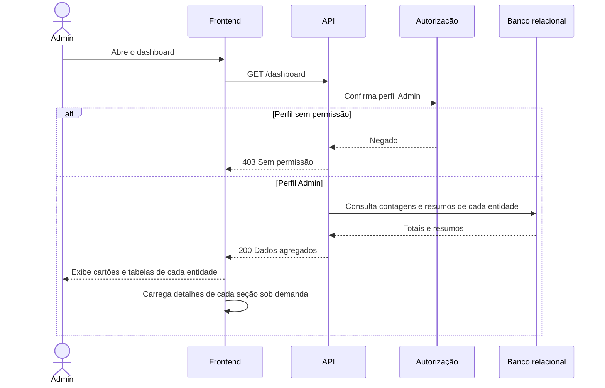

# RF29 — Dashboard do Admin

**Requisito:** o Admin visualiza todas as entidades do sistema (usuários, filmes, salas, sessões, clientes e reservas) em um dashboard.
**Personas:** Admin.
**RNFs realizados:** [RNF06](../../requisitos-nao-funcionais.md) (latência), [RNF08](../../requisitos-nao-funcionais.md) (vazão), [RNF37](../../requisitos-nao-funcionais.md) (componente de painel), [RNF38](../../requisitos-nao-funcionais.md) (observabilidade).
**Entidades:** Usuario, Filme, Sala, Sessao, Cliente, Reserva ([classes](../estatica/classes.md)).

## Diagrama de sequência

## Notas de RNF

- **RNF06 e RNF08:** o dashboard lê agregados, não listas inteiras. Isso mantém a resposta pequena mesmo com muitos registros.
- **RNF37:** cada seção é um componente isolado, carregado quando aparece.
- **RNF38:** o dashboard é observado pelas métricas do sistema, e as métricas de carga de C5 ficam disponíveis para o Admin.
- O Admin também usa o dashboard para acompanhar a integridade descrita em [RNF01](../../requisitos-nao-funcionais.md).
