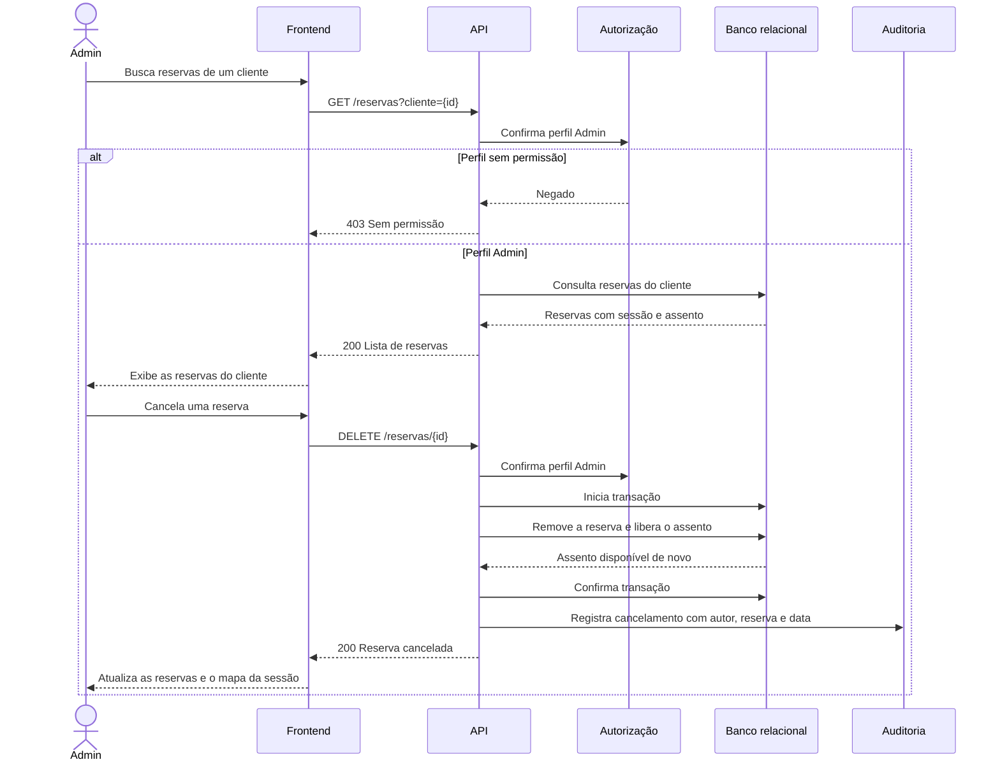

# RF30 — Cancelamento de reserva pelo Admin

**Requisito:** o Admin consulta as reservas de qualquer cliente e cancela, liberando os assentos.
**Personas:** Admin.
**RNFs realizados:** [RNF01](../../requisitos-nao-funcionais.md) (integridade), [RNF26](../../requisitos-nao-funcionais.md) (durabilidade), [RNF29](../../requisitos-nao-funcionais.md) (autorização), [RNF33](../../requisitos-nao-funcionais.md) (auditoria).
**Entidades:** Reserva, Assento, Cliente, RegistroAuditoria ([classes](../estatica/classes.md)).

## Diagrama de sequência

## Notas de RNF

- **RNF01:** ao cancelar, o assento volta a ficar livre na mesma transação. Não há intervalo em que ele apareça ocupado e livre ao mesmo tempo.
- **RNF26:** o cancelamento só responde 200 depois do commit.
- **RNF29:** a rota exige perfil Admin no servidor.
- **RNF33:** o cancelamento grava registro de auditoria com autor, reserva, assento, cliente e data.
- O mapa de assentos ([RF20](RF20-mapa-assentos.md)) mostra o assento livre na próxima consulta, sem depender do cache.
