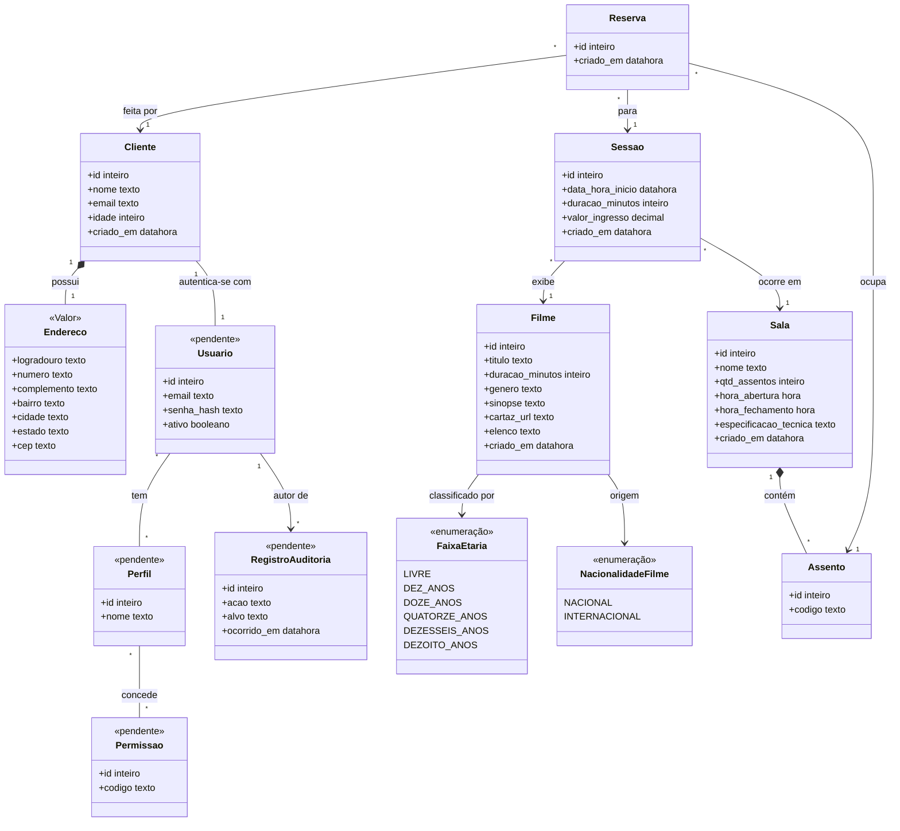

# Diagrama de Classes — Entidades do CineSenac

**Tipo:** modelagem estática
**Status:** Rascunho para validação
**Relacionado:** [componentes.md](componentes.md) · [dbdiagram.dbml](../../dbdiagram.dbml) · [requisitos-funcionais.md](../../requisitos-funcionais.md)

Diagrama de classes que delimita as **entidades** do domínio. Os tipos são genéricos (`inteiro`, `texto`, `datahora`, `decimal`, `booleano`, `data`), sem tecnologia de banco ou linguagem.

Entidades marcadas com **(pendente)** não existem no [dbdiagram.dbml](../../dbdiagram.dbml) atual. São exigidas pelos RF27, RF28 e RNF33 e precisam de confirmação antes de virar tabela.

---

## Diagrama

---

## Restrições de unicidade e integridade

| Entidade | Restrição | Regra | RFs | RNFs |
|---|---|---|---|---|
| Cliente | `email` único | Um e-mail por conta. | RF05 | RNF03 |
| Assento | `(sala, codigo)` único | Código de assento único dentro da sala. | RF11 | RNF41 |
| Sessao | Sem sobreposição na mesma `Sala` | Intervalo `[data_hora_inicio, início + duração)` não se cruza com outra sessão da sala. Validado com bloqueio por sala. | RF15 | RNF04 |
| Reserva | `(sessao, assento)` único | Um assento só é reservado uma vez por sessão. | RF23 | RNF01 |
| Reserva | Sem sobreposição por `Cliente` | Um cliente não reserva sessões com horários conflitantes. Validado com bloqueio por cliente. | RF24 | RNF02 |
| Reserva | Atomicidade | Reservas de múltiplos assentos são gravadas juntas ou não são gravadas. | RF22 | RNF25 |
| Filme | Cota nacional | Todo dia publicado precisa de ao menos uma sessão de filme `NACIONAL`. Validada na publicação. | RF18, RF19 | RNF05 |

---

## Mapeamento para o DBML atual

| Classe | Tabela no DBML | Situação |
|---|---|---|
| Cliente + Endereco | `clientes` | Endereço incorporado na mesma tabela (relação 1:1), como no DBML. |
| Filme | `filmes` | Conforme. |
| Sala | `salas` | Conforme. |
| Assento | `assentos` | Conforme. |
| Sessao | `sessoes` | Conforme. |
| Reserva | `reservas` | Conforme. |
| FaixaEtaria, NacionalidadeFilme | `enum faixa_etaria`, `enum nacionalidade_filme` | Conforme. |
| Usuario, Perfil, Permissao | Não existe | **Pendente.** Necessário para RF01, RF02, RF27 e RF28. |
| RegistroAuditoria | Não existe | **Pendente.** Necessário para RNF33. |

> Ponto de atenção: `Cliente` e `Usuario` são separados para que o login de Gestor e Admin use a mesma estrutura de credenciais. Se o time preferir que `Cliente` contenha as credenciais, a relação `1..1` deixa de existir, mas a regra de login continua a mesma.
