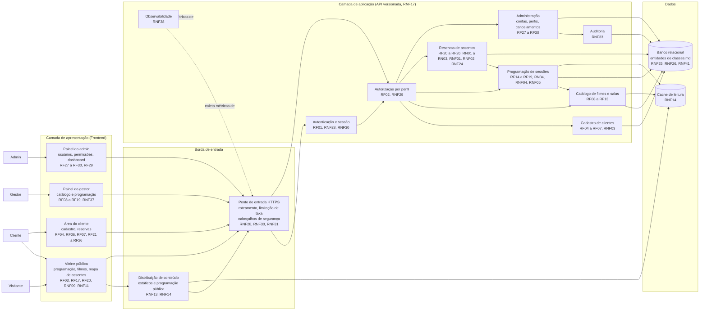

# Diagrama de Componentes — CineSenac

**Tipo:** modelagem estática
**Status:** Rascunho para validação
**Relacionado:** [classes.md](classes.md) · [requisitos-funcionais.md](../../requisitos-funcionais.md) · [requisitos-nao-funcionais.md](../../requisitos-nao-funcionais.md)

Diagrama de componentes **agnóstico de tecnologia**: mostra as responsabilidades do sistema e como elas se comunicam, sem escolher linguagem, framework, banco ou provedor. Cada componente indica os RFs e RNFs que atende.

---

## Visão geral

---

## Componentes e responsabilidades

| Componente | Responsabilidade | RFs | RNFs |
|---|---|---|---|
| Vitrine pública | Programação e filmes para qualquer visitante; mapa de assentos. | RF03, RF17, RF20 | RNF06, RNF09, RNF11, RNF14, RNF27 |
| Área do cliente | Cadastro próprio, reserva de assentos e lista de reservas. | RF04, RF06, RF07, RF21 a RF26 | RNF10, RNF19, RNF21, RNF22 |
| Painel do gestor | Catálogo, salas, sessões, cota nacional e publicação. | RF08 a RF19 | RNF05, RNF13, RNF22, RNF37 |
| Painel do admin | Contas, perfis, dashboard e cancelamentos. | RF27 a RF30 | RNF29, RNF33, RNF37 |
| Ponto de entrada | Único acesso externo; HTTPS, limitação de tentativas de login, cabeçalhos de segurança. | RF01 | RNF28, RNF30, RNF31 |
| Distribuição de conteúdo | Serve estáticos e a programação pública com TTL curto. | RF03, RF17 | RNF13, RNF14 |
| Autenticação e sessão | Valida credenciais, emite e expira sessão. | RF01 | RNF28, RNF30 |
| Autorização por perfil | Valida o perfil em toda rota. É o controle de acesso real. | RF02 | RNF29 |
| Cadastro de clientes | Criação, edição e consulta do próprio cadastro; e-mail único. | RF04 a RF07 | RNF03, RNF31, RNF32 |
| Catálogo | Filmes e salas, com listagem e busca. | RF08 a RF13 | RNF13, RNF22, RNF37 |
| Programação | Sessões, sobreposição na sala (RF15) e cota nacional (RN04). | RF14 a RF19 | RNF04, RNF05, RNF34 |
| Reservas | Seleção, reserva atômica e idempotente, conflito de horário. | RF20 a RF26 | RNF01, RNF02, RNF07, RNF24, RNF25 |
| Administração | Contas, permissões e cancelamento de reservas pelo admin. | RF27, RF28, RF30 | RNF26, RNF29, RNF33 |
| Auditoria | Registro de ações administrativas e cancelamentos. | RF16, RF27, RF28, RF30 | RNF33 |
| Observabilidade | Latência, erros e saturação por rota. | RF29 | RNF36, RNF38 |
| Banco relacional | Persistência transacional e restrições de unicidade. | Todos | RNF01, RNF03, RNF25, RNF26, RNF41 |
| Cache de leitura | Absorve leitura da programação pública. Nunca guarda o mapa de assentos além do TTL. | RF03, RF17 | RNF14 |

---

## Interfaces entre componentes

| De | Para | Conteúdo | Observação |
|---|---|---|---|
| Frontend | Ponto de entrada | Requisições HTTPS da API versionada | Contrato documentado (RNF17). |
| Frontend | Distribuição de conteúdo | Programação pública e estáticos | Apenas leitura pública (RF03, RF17). |
| Autorização | Demais componentes | Perfil e permissões do usuário autenticado | Toda rota passa pela autorização (RNF29). |
| Reservas | Banco | Transação com restrição única por assento na sessão | Garante RNF01 e RNF25. |
| Programação | Banco | Consulta e inserção de sessões em transação com bloqueio por sala | Garante RNF04. |
| Administração | Auditoria | Evento com autor, ação, alvo e data | Garante RNF33. |

---

## Decisões de arquitetura pendentes

As decisões D1 a D7 estão em [requisitos-nao-funcionais.md](../../requisitos-nao-funcionais.md#3-considerações-de-frontend). O diagrama não as decide: ele mostra os componentes necessários, e o [@architect](../../../.github/agents/architect.agent.md) escolhe a tecnologia de cada um.
